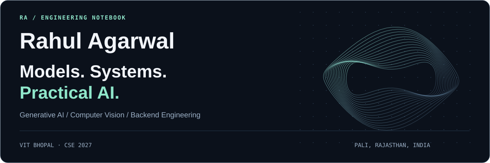
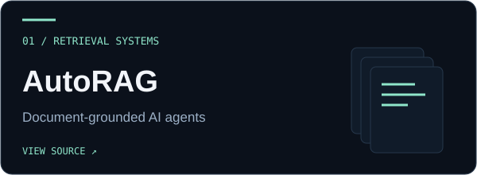
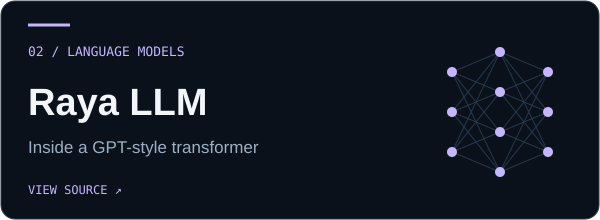
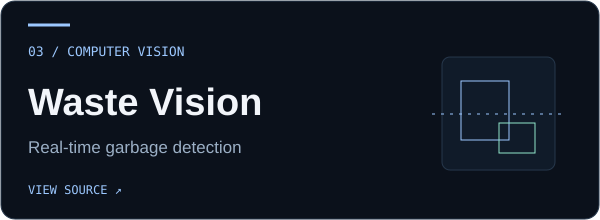
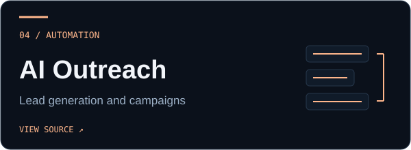
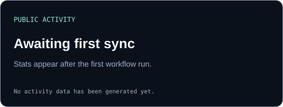

  

  
  
  

  <a href="#selected-work">Selected work</a> &nbsp; / &nbsp;
  <a href="#toolkit">Toolkit</a> &nbsp; / &nbsp;
  <a href="#background">Background</a> &nbsp; / &nbsp;
  <a href="#github-activity">Activity</a>

I'm **Rahul**, a Computer Science undergraduate at **VIT Bhopal**, based in **Pali, Rajasthan**. I build AI applications across document retrieval, language modeling, computer vision, and workflow automation.

My interests span the full path from preparing data and evaluating models to connecting them with APIs, background jobs, and usable interfaces.

## Selected work

<table>
<tr>
<td width="50%" valign="top">

<strong>Documents into source-cited answers.</strong> Guided agent configuration, document ingestion, vector retrieval, and tool calling.

<code>FastAPI</code> <code>LangGraph</code> <code>Temporal</code> <code>Qdrant</code>

<a href="https://github.com/RahulAgarwal701/AutoRAG"><strong>Explore AutoRAG →</strong></a>
</td>
<td width="50%" valign="top">

<strong>Inside a language model.</strong> A 12-layer, 12-head transformer with a training pipeline and configurable text generation.

<code>PyTorch</code> <code>tiktoken</code> <code>NumPy</code> <code>AdamW</code>

<a href="https://github.com/RahulAgarwal701/Raya__LLM"><strong>Explore Raya LLM →</strong></a>
</td>
</tr>
<tr>
<td width="50%" valign="top">

<strong>Computer vision for waste monitoring.</strong> Custom object detection on video streams, with bounding boxes and visual alerts.

<code>YOLOv11</code> <code>OpenCV</code> <code>Roboflow</code> <code>Albumentations</code>

<a href="https://github.com/RahulAgarwal701/Garbage_Detection"><strong>Explore Garbage Detection →</strong></a>
</td>
<td width="50%" valign="top">

<strong>From business data to outreach.</strong> Web extraction, structured profiles, personalized emails, and campaign monitoring.

<code>Playwright</code> <code>SQLAlchemy</code> <code>Celery</code> <code>Redis</code>

<a href="https://github.com/RahulAgarwal701/Outreach_Platform"><strong>Explore Outreach Platform →</strong></a>
</td>
</tr>
</table>

<strong>Under the hood — what I worked on</strong>

- **AutoRAG:** document parsing, chunking, embedding, and indexing; Temporal workflows with failure recovery; LangGraph retrieval and tool calling; authenticated APIs and embeddable chat.
- **Raya LLM:** sliding-window datasets, AdamW, checkpointing, training/validation loss analysis, greedy decoding, temperature scaling, and top-k sampling.
- **Garbage Detection:** image annotation and augmentation, YOLOv11 training, OpenCV inference, and dashboard alerts.
- **Outreach Platform:** extracting seven business metrics, cleaning records, SQLAlchemy persistence, Grok API personalization, and asynchronous email processing.

## Toolkit

| Focus | Technologies |
| :--- | :--- |
| **Programming & data** | Python · Java · SQL · NumPy · Pandas |
| **Machine learning & vision** | PyTorch · TensorFlow · Keras · YOLO · OpenCV · Albumentations |
| **LLMs & retrieval** | Transformers · RAG · LangGraph · Sentence Transformers · tiktoken · Qdrant |
| **APIs & workflows** | FastAPI · SQLAlchemy · Temporal · Celery · Redis · Playwright · Streamlit |
| **Cloud & storage** | AWS S3 / EC2 / SageMaker · PostgreSQL · MySQL · Docker · Git |

## Background

**B.Tech, Computer Science and Engineering — VIT Bhopal**  
2023–2027 · CGPA: **8.84/10**

| Experience | Period |
| :--- | :--- |
| **Research Associate Intern** · RS Mech Tech Pvt. Ltd., Ahmedabad | May–Jul 2026 |
| **Computer Vision Intern** · Mantra Softech Pvt. Ltd., Ahmedabad | May–Jun 2025 |

<strong>Certifications & research</strong>

- **AWS Certified AI Practitioner** · AIF-C01 · 2026 · [Credential link](https://drive.google.com/file/d/1N5ytQRC1PIaLWHGNH8xS6LDe_reoB-O3/view?usp=sharing)
- **AWS Certified Machine Learning Engineer – Associate** · MLA-C01 · 2026 · [Credential link](https://drive.google.com/file/d/1_dekXiTpCvFsPuMnoANaqVV8lHRQP8f1/view?usp=sharing)
- **Co-authored research manuscript:** *Real-Time Garbage Detection and Alert System Using CCTV Surveillance and Deep Learning*, VIT Bhopal University. Covers YOLO-based detection, system architecture, model comparisons, and low-light limitations.

## GitHub activity

  
  

  

Public activity only. Language distribution reflects repository contents, not proficiency.

---

### Let's build something useful.

Open to **AI/ML internships, engineering collaborations, and thoughtful conversations about building AI applications**.

[Get in touch →](mailto:agarwalrahul0100@gmail.com) &nbsp; [Connect on LinkedIn →](https://linkedin.com/in/rahul701)

Design & open-source credits

Custom artwork and layout, with component inspiration from [GPRM](https://github.com/VishwaGauravIn/github-profile-readme-maker) and the [Awesome GitHub Profile README](https://github.com/abhisheknaiidu/awesome-github-profile-readme) gallery. Stats are powered by [GitHub Readme Stats](https://github.com/anuraghazra/github-readme-stats); the contribution calendar uses [lowlighter/metrics](https://github.com/lowlighter/metrics).

